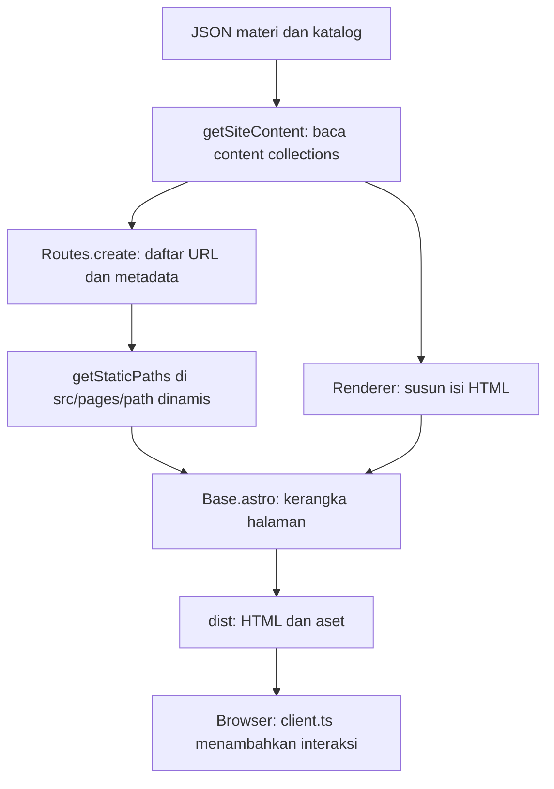

# Astro dari nol untuk proyek ini

Astro mengubah source proyek menjadi halaman website. Pada Git Guides, perintah `npm run build` membuat HTML untuk setiap materi dan halaman lain, lalu menyimpannya di `dist/`. Ketika pengunjung membuka satu pelajaran, isi bacaan sudah ada di HTML. JavaScript menambahkan tombol, kuis, pencarian, dan simulator.

Kamu tetap memakai HTML, CSS, dan JavaScript. Astro menambahkan cara membagi halaman menjadi komponen, membaca materi terstruktur, dan menghasilkan banyak URL dari satu template.

## Menjalankan proyek pertama kali

Pasang Node.js 24 dan Git, lalu buka terminal pada folder proyek yang berisi `package.json`. Semua command dalam panduan ini dijalankan dari folder tersebut.

```powershell
node --version
git --version
npm ci
npm run dev
```

`npm ci` memasang dependency sesuai versi dalam `package-lock.json`. Jalankan pada checkout baru atau ketika ingin memasang ulang dependency yang sudah dikunci. Untuk menambahkan paket baru gunakan `npm install`, yang memperbarui `package.json` dan lockfile.

Astro mencetak URL server, biasanya `http://localhost:4321/`. Jika port itu sudah digunakan, lihat URL yang benar pada terminal. Biarkan terminal ini berjalan saat mengedit; hentikan dengan `Ctrl+C`. Di PowerShell yang menolak `npm.ps1`, gunakan `npm.cmd`, misalnya `npm.cmd run dev`.

Pastikan server lama dari versi tanpa Astro sudah dihentikan jika kamu ingin memakai port yang sama. Website sekarang dijalankan melalui Astro; source `index.html` lama sudah digantikan.

## Arti command yang dipakai sehari-hari

| Command                | Dipakai untuk                                                        |
| ---------------------- | -------------------------------------------------------------------- |
| `npm run dev`          | Mengembangkan website dan melihat perubahan source di browser.       |
| `npm run check`        | Memeriksa data materi, TypeScript, dan komponen Astro.               |
| `npm test`             | Menguji server development, Git sungguhan, progres, dan hasil build. |
| `npm run build`        | Menghasilkan website statis di `dist/`.                              |
| `npm run preview`      | Membuka hasil build terakhir melalui server lokal.                   |
| `npm run test:browser` | Menguji hasil build dengan browser otomatis.                         |
| `npm run format`       | Merapikan format file source yang tercakup dalam script.             |

`preview` menampilkan hasil build terakhir. Setelah menyunting source, jalankan `build` lagi jika ingin perubahan itu terlihat di preview.

## Isi file `.astro`

Contoh berikut hanya untuk memahami sintaks. Contoh penambahan halaman yang lengkap untuk Git Guides ada di [panduan edit halaman](panduan-edit-halaman.md#contoh-4-menambah-halaman-tentang).

```astro
---
const judul = 'Belajar Git';
const jumlahMateri = 66;
---

<section>
  <h1>{judul}</h1>
  <p>Ada {jumlahMateri} materi yang bisa dipelajari.</p>
</section>
```

Bagian di antara `---` adalah frontmatter komponen: import, pembacaan data, dan persiapan variabel untuk render. Pada build statis, bagian ini berjalan ketika Astro membuat HTML. Pada development, Astro juga menjalankannya untuk melayani halaman yang sedang dikembangkan. Kode ini tidak otomatis menjadi JavaScript browser.

Bagian di bawah `---` adalah template HTML. Tanda `{judul}` memasukkan nilai variabel ke template. Komponen lain bisa digunakan melalui import:

```astro
---
import GettingStarted from '../components/GettingStarted.astro';
---

<GettingStarted />
```

Untuk menangani klik, gunakan script browser. Pada proyek ini, [Base.astro](../src/layouts/Base.astro) memuat [client.ts](../src/scripts/client.ts) melalui `<script>`. Kode yang membutuhkan `document`, `window`, atau `localStorage` berada pada jalur browser itu.

## Layout, komponen, dan template proyek

**Layout** adalah kerangka yang dipakai berulang: metadata, header, sidebar, tempat isi halaman, dan footer. Di proyek ini layout-nya adalah `src/layouts/Base.astro`.

**Komponen** adalah bagian tampilan yang dapat dipasang pada halaman. `src/components/GettingStarted.astro` berisi panduan instalasi dan repo pertama.

**Renderer** di `src/renderers/` adalah fungsi JavaScript yang mengembalikan string HTML. Ini cara proyek mempertahankan template yang sudah ada sambil memakai Astro untuk halaman dan build. Misalnya, `home()` dalam `catalog.js` menghasilkan isi beranda. String itu dimasukkan ke layout melalui `<Fragment set:html={markup} />`.

Jadi ketika ingin mengganti judul beranda, kamu mengedit `home()` dalam file JavaScript. Ketika ingin mengganti header semua halaman, kamu mengedit HTML di `Base.astro`. Lihat [peta URL dan file](panduan-edit-halaman.md#peta-url-ke-file) agar tidak perlu menebak.

## Dari satu JSON ke satu halaman materi



Nama file route sebenarnya adalah `src/pages/[...path].astro`. Tanda `[...path]` berarti route dinamis dengan beberapa segmen URL. `getStaticPaths()` menyediakan daftar alamat yang perlu dibuat saat build.

Astro mendukung halaman langsung dari file dalam `src/pages/`. Khusus katalog Git Guides, sebagian besar halaman didaftarkan di `src/lib/routes.js`, lalu dibuat oleh route dinamis tersebut. Cara ini membuat daftar route, metadata, sitemap, dan pemeriksaan link tetap konsisten. Materi JSON tidak otomatis menjadi halaman hanya karena masuk folder; route proyek ini yang menghubungkannya.

## Source yang diedit dan hasil yang dihasilkan

| Lokasi                        | Perannya                                           | Cara memperbarui                                                            |
| ----------------------------- | -------------------------------------------------- | --------------------------------------------------------------------------- |
| `src/`                        | Komponen, data, dan kode aplikasi.                 | Edit source sesuai kebutuhan.                                               |
| `assets/styles.css`           | Source CSS global.                                 | Edit, lalu jalankan persiapan aset atau restart development server.         |
| `assets/fonts/`               | Font lokal beserta lisensi.                        | Edit aset sumber jika diperlukan, lalu jalankan persiapan aset.             |
| `labs/`                       | Source generator dan petunjuk dalam paket latihan. | Edit, lalu build ulang.                                                     |
| `public/assets/`              | Salinan aset yang dilayani browser.                | Dibuat oleh `scripts/prepare-assets.mjs`; perubahan langsung akan tertimpa. |
| `dist/`                       | Hasil build website.                               | Dibuat ulang oleh `npm run build`.                                          |
| `.astro/`, `node_modules/`    | Data kerja Astro dan dependency terpasang.         | Dikelola alatnya.                                                           |
| `artifacts/`, `test-results/` | Screenshot, catatan lokal, dan hasil pengujian.    | Keluaran pemeriksaan lokal.                                                 |

File `assets/content.js`, `assets/pages.js`, `assets/routes.js`, `assets/simulator.js`, dan `assets/visuals.js` merupakan penghubung untuk pengujian. Logika aplikasinya berada di `src/`. Untuk mengubah perilaku, gunakan file source yang ditunjuk panduan edit.

## Latihan pertama: ubah satu teks

1. Jalankan `npm run dev` dan buka beranda.
2. Buka `src/renderers/catalog.js`.
3. Cari fungsi `home()` dan teks `Lebih dari sekadar`.
4. Ganti kalimat pada `<h1 class="page-title">` tanpa mengubah nama class atau struktur fungsi.
5. Simpan file, lalu periksa beranda. Bila browser belum berubah, reload halaman.
6. Jalankan `npm run check` untuk memastikan source tetap valid.

Penjelasan lengkap untuk judul tab, tombol, warna, dan halaman baru ada di [panduan edit halaman](panduan-edit-halaman.md).

## Masalah yang sering muncul

| Gejala                                     | Yang diperiksa                                                                       |
| ------------------------------------------ | ------------------------------------------------------------------------------------ |
| Port 4321 menampilkan tampilan lama        | Baca URL di terminal Astro. Hentikan server lama jika ingin memakai port yang sama.  |
| CSS yang diedit belum berubah              | Jalankan `node scripts/prepare-assets.mjs`, lalu reload; atau restart `npm run dev`. |
| Preview belum berubah                      | Jalankan `npm run build` sebelum membuka preview lagi.                               |
| JSON ditolak                               | Baca nama file dan field pada error; periksa koma, tanda kutip ganda, dan schema.    |
| `window is not defined`                    | Pindahkan akses API browser dari frontmatter/render server ke script browser.        |
| `module is not defined` pada source `src/` | Gunakan `import`/`export`. Folder `src/` memakai ESM melalui `src/package.json`.     |
| Tombol terlihat tetapi tidak merespons     | Periksa error Console browser dan pasangan `id`/`data-*` yang dipakai `client.ts`.   |

## Bacaan resmi

- [Komponen Astro](https://docs.astro.build/en/basics/astro-components/): frontmatter dan template.
- [Routing Astro](https://docs.astro.build/en/guides/routing/): file halaman, route dinamis, dan `getStaticPaths()`.
- [Scripts and event handling](https://docs.astro.build/en/guides/client-side-scripts/): JavaScript yang berjalan di browser.
- [Content collections](https://docs.astro.build/en/guides/content-collections/): data terstruktur dan validasi.
